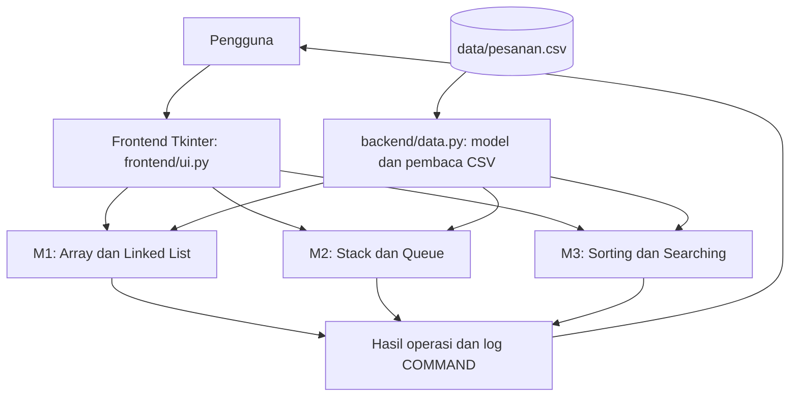
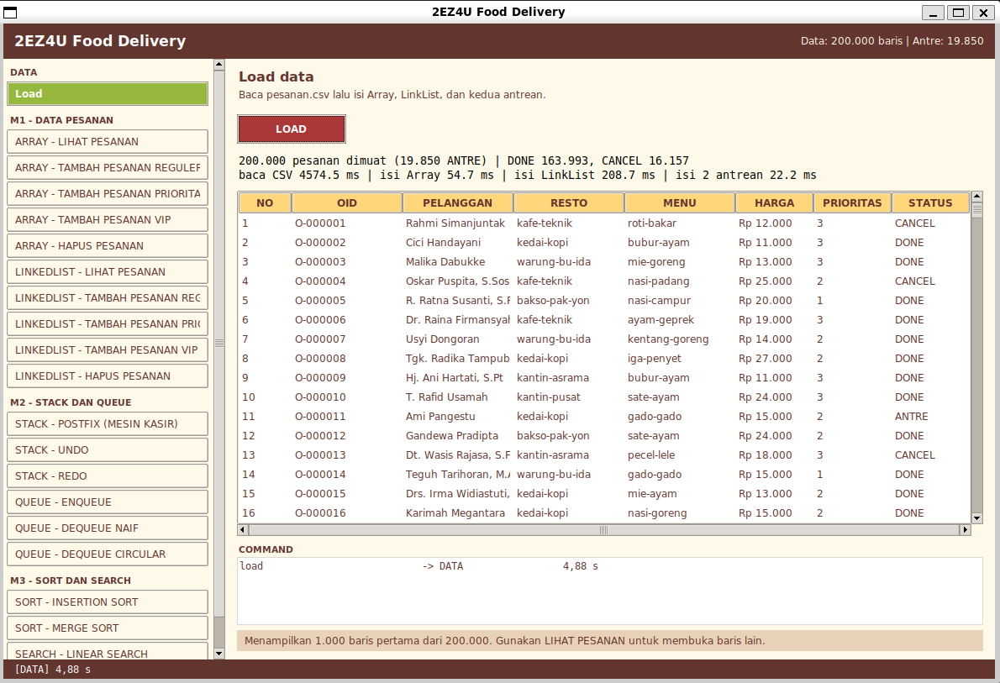

# 2EZ4U APP
**Dibuat oleh:** Jauza Hafizhoh  
**NRP:** 5024251113  

## Deskripsi
Aplikasi desktop sederhana untuk simulasi layanan pesan-antar makanan, dikembangkan sebagai proyek mata kuliah Struktur Data & Analisa Algoritma, Departemen Teknik Komputer ITS.

Aplikasi dibuat menggunakan **Python 3** dan **Tkinter**. Fokus implementasi saat ini adalah milestone M1, M2, dan M3: pengelolaan pesanan menggunakan Array dan Linked List, operasi Stack dan Queue, serta algoritma Sorting dan Searching.

## Fitur
### M1: Data Pesanan: Array dan Linked List
- Memuat data pesanan dari `data/pesanan.csv`.
- Menampilkan pesanan melalui struktur Array maupun Linked List.
- Menambahkan pesanan REGULER, PRIORITAS, dan VIP.
- Menghapus pesanan.
- Memperlihatkan hasil operasi struktur data yang dipilih.

### M2: Stack dan Queue
- Mengimplementasikan Stack untuk mendukung Undo dan Redo aksi antrean.
- Mengonversi ekspresi matematika dari Infix ke Postfix.
- Menghitung hasil ekspresi Postfix.
- Mengimplementasikan Queue dan Circular Queue.
- Membandingkan dequeue antrean naif dengan Circular Queue.
- Mendukung Undo dan Redo untuk aksi enqueue/dequeue.

### M3: Sorting dan Searching
- Insertion Sort.
- Merge Sort.
- Linear Search berdasarkan OID.
- Binary Search berdasarkan OID.
- Menampilkan hasil operasi dan informasi pengukuran yang disediakan aplikasi, seperti jumlah perbandingan dan waktu eksekusi.
- Insertion Sort dibatasi untuk jumlah data tertentu agar pemrosesan data besar tidak membuat aplikasi tidak responsif.

## Teknologi dan batasan implementasi
- Python 3.11 atau lebih baru direkomendasikan.
- Tkinter untuk antarmuka desktop.
- Data awal disimpan dalam CSV.
- Struktur data dan algoritma inti diimplementasikan sendiri untuk kebutuhan pembelajaran. Proyek mengikuti batasan tugas terhadap penggunaan fungsi instan tertentu seperti `sorted()`, `.sort()`, `dict`, `set`, `heapq`, `bisect`, dan `collections` pada implementasi inti.

## Struktur direktori
```text
2ez4u/
├── app.py
├── README.md
├── backend/
│   ├── __init__.py
│   ├── data.py
│   ├── m1_pesanan.py
│   ├── m2_antrean.py
│   └── m3_laporan.py
├── frontend/
│   ├── __init__.py
│   ├── ui.py
│   └── menu.py
├── data/
    └── pesanan.csv
```

## Diagram arsitektur


## Screenshot

Berikut tampilan awal aplikasi 2EZ4U APP.



## Persyaratan

- Python 3.11+
- Tkinter tersedia pada instalasi Python.
- File `data/pesanan.csv` tersedia di lokasi yang benar.

Untuk Ubuntu/WSL, jika Tkinter belum tersedia, jalankan:

```bash
sudo apt update
sudo apt install python3-tk
```

## Cara menjalankan

1. Clone repository atau unduh proyek.
2. Buka terminal pada direktori utama proyek, yaitu direktori yang berisi `app.py`.
3. Pastikan dataset berada di `data/pesanan.csv`.
4. Jalankan aplikasi:

```bash
python3 app.py
```
5. Pada jendela aplikasi, pilih menu operasi di sebelah kiri, masukkan parameter yang diperlukan, lalu jalankan operasi. Periksa panel hasil dan `COMMAND / LOG` untuk melihat hasilnya.

### Mengapa Circular Queue Menggunakan `count`?

Circular Queue menggunakan tiga variabel utama, yaitu `front`, `rear`, dan `count`.

- `front` menunjukkan posisi elemen terdepan.
- `rear` menunjukkan posisi untuk memasukkan elemen berikutnya.
- `count` menyimpan jumlah elemen yang sedang berada di antrean.

Variabel `count` diperlukan karena jika hanya menggunakan `front` dan `rear`, kondisi antrean kosong dan penuh dapat sama-sama menghasilkan `front == rear`. Akibatnya, kedua kondisi tersebut tidak dapat dibedakan hanya berdasarkan kedua penunjuk itu.

Ada dua pendekatan yang umum digunakan:
1. Menyimpan variabel `count` untuk mengetahui jumlah elemen yang sedang tersimpan.
2. Menyisakan satu slot kosong agar kondisi penuh dan kosong dapat dibedakan.

Pada proyek 2EZ4U APP, pendekatan pertama dipilih karena **lebih sederhana** untuk implementasi ini. Kondisi kosong diperiksa melalui `count == 0`, sedangkan kondisi penuh diperiksa melalui `count == kapasitas`. Jika penuh, kapasitas antrean diperbesar.

Pendekatan ini memungkinkan seluruh slot digunakan tanpa mengorbankan kemampuan membedakan kondisi kosong dan penuh.

### Perbandingan Jumlah Perbandingan Sorting

Pengujian dilakukan menggunakan Insertion Sort dan Merge Sort dengan ukuran data yang berbeda. Kedua algoritma mengurutkan data berdasarkan harga dan mencatat jumlah perbandingan elemen.

| Jumlah Data (n) | Insertion Sort | Merge Sort | Rasio Perbandingan |
|---:|---:|---:|---:|
| 500 | 55.847 | 3.835 | 15x |
| 1.000 | 233.802 | 8.644 | 27x |
| 2.000 | 962.430 | 19.216 | 50x |
| 4.000 | 3.831.520 | 42.368 | 90x |
| 8.000 | 15.058.881 | 92.647 | 163x |
| 16.000 | 60.049.240 | 200.926 | 299x |

Rasio perbandingan menunjukkan banyaknya perbandingan Insertion Sort dibandingkan Merge Sort untuk ukuran data yang sama. Angka rasio dibulatkan ke bilangan bulat terdekat.
